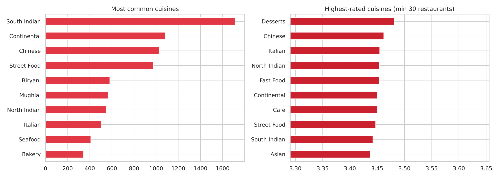
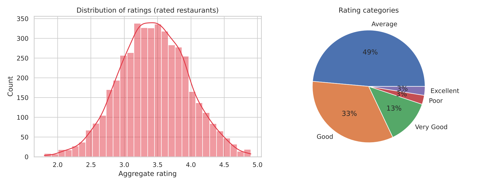
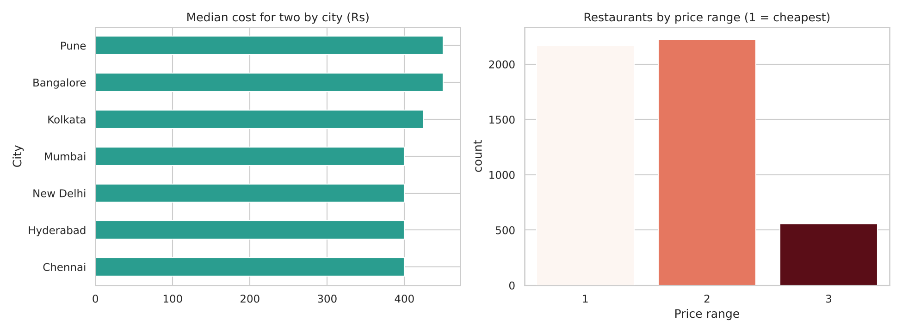
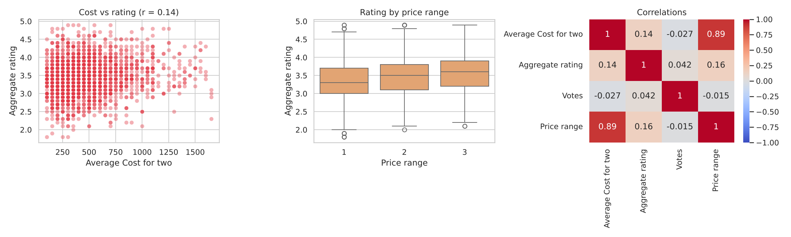
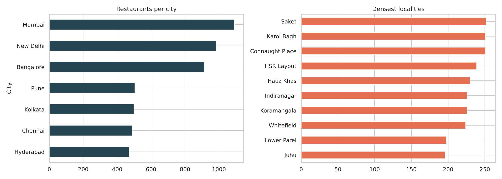
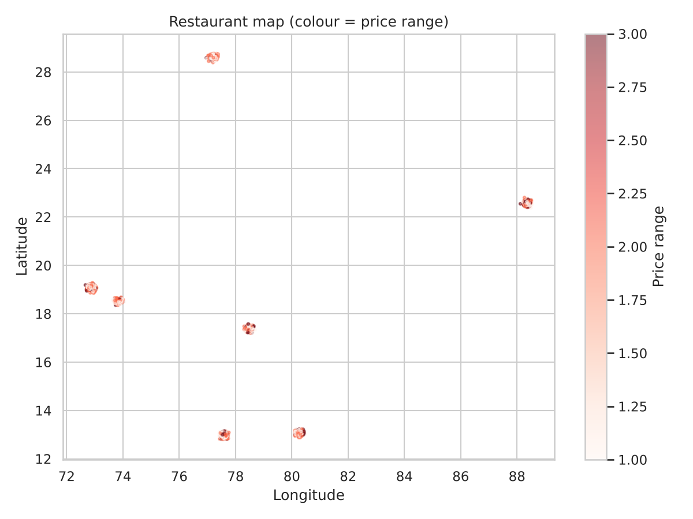

# Zomato India Restaurant Analysis

**Level:** Beginner  
> Cuisines, ratings, pricing and restaurant density across Indian cities.

> **Before you publish:** this repo ships with a *synthetic sample dataset* in the same format as the real one so everything runs out of the box. Download the real dataset (see below), put it at `data/zomato_india.csv`, re-run, and replace the Key Insights section with your real numbers. Then delete this note.

## Business questions

- Which cuisines are best?
- How are ratings distributed?
- How do prices vary?
- Does a higher cost mean a better rating?
- Where are restaurants concentrated?

## Dataset

- Zomato Restaurants Data (Kaggle) - India subset (Country Code = 1)
- Expected location: `data/zomato_india.csv` (search the dataset name on Kaggle to download it)
- If the file is missing, `generate_data.py` creates a sample with the same columns automatically.

## Skills demonstrated

Pandas, `explode`, handling a 0 = 'not rated' trap, correlation, Seaborn, simple geo scatter

## Project structure

```
README.md
analysis.ipynb         notebook (cells run top to bottom)
analysis.py            same analysis as a script
cleaned_dataset.csv
images/               charts used in this README
data/                 raw data goes here
generate_data.py      sample-data generator
requirements.txt
```

## How to run

```bash
pip install -r requirements.txt
python analysis.py             # or: jupyter notebook analysis.ipynb
```

## Key insights

_Run the analysis and paste the five printed insights here, each with a recommendation. Example format:_

1. **Finding with a number** - e.g. "Month-to-month contracts churn at 3x the rate of two-year contracts."
   - *Recommendation:* what the business should do about it.
2. ...

## Visualizations








## Interview talking points

- Why zero ratings were excluded (they mean 'not rated').
- Why cost and rating are only weakly correlated.

## Resume bullet (fill in your numbers)

> Analysed [N]+ Indian restaurants: ranked cuisines, mapped price vs rating and restaurant density by city and locality.

## Tech stack

Python, Pandas, NumPy, Matplotlib, Seaborn, Jupyter
